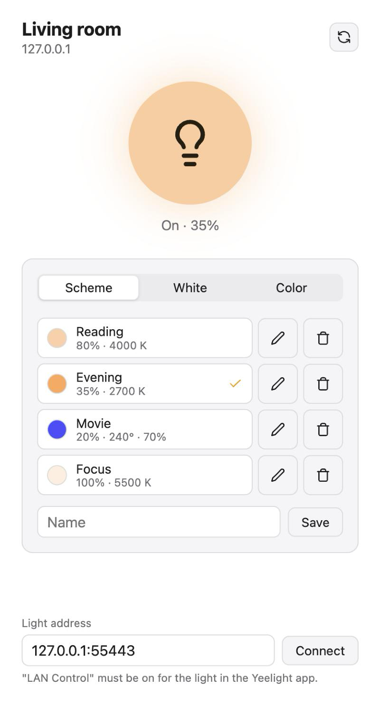

# Yeelight

Control a Yeelight bulb from your browser, phone or desktop over your local network: switch it on and off, set
brightness, color temperature and color, and save your favorite settings as named schemes.



The same page comes in two forms:

- **[Desktop app](#desktop-app)** for macOS, Windows and Linux: download it and run it, nothing else needed.
- **[Web](#running-with-docker)**: a small Docker image serving the page on your LAN. Open it in any browser; on a
  phone it can be installed to the home screen as an app (PWA).

## Before you start

Enable **LAN Control** for the bulb in the bulb's settings in the official Yeelight app. Without it the
bulb doesn't accept commands from the network. The app speaks the
[Yeelight Inter-Operation Spec](http://www.yeelight.com/download/Yeelight_Inter-Operation_Spec.pdf).

## Desktop app

Download the app for your system from the [latest release](https://github.com/oneryx/yeelight/releases/latest):

| System                | File                                                                                    |
| --------------------- | --------------------------------------------------------------------------------------- |
| macOS                 | `Yeelight.<version>.dmg` (Apple Silicon and Intel): open it, drag Yeelight to Applications |
| Windows               | `Yeelight.Setup.<version>.amd64.exe` (or `arm64`): run the installer                    |
| Debian, Ubuntu        | `yeelight_<version>_amd64.deb` (or `arm64`): `sudo apt install ./yeelight_*.deb`        |
| Other Linux           | `yeelight-<version>-linux-amd64.tar.gz` (or `arm64`) and `install.sh`: download both into one folder and run `sh install.sh` |

The app finds the bulb on your network by itself; if it doesn't (a firewall blocking multicast, say), enter the
bulb's address at the bottom of the window. On Linux it needs WebKitGTK: the `.deb` installs it, and `install.sh`
prints the command to install it if it's missing.

The app isn't signed with a paid developer certificate, so the system warns the first time you open it:

- **macOS** says the app can't be opened. Open **System Settings → Privacy & Security**, scroll down and click
  **Open Anyway** next to the message about Yeelight. Or run
  `xattr -dr com.apple.quarantine /Applications/Yeelight.app` once.
- **Windows** SmartScreen says it protected your PC: click **More info**, then **Run anyway**.

## Running with Docker

A prebuilt image is published for `linux/amd64`, `linux/arm64` and `linux/arm/v7`:

```
ghcr.io/oneryx/yeelight:latest
```

### docker compose

```yaml
services:
  yeelight:
    image: ghcr.io/oneryx/yeelight:latest
    container_name: yeelight
    restart: unless-stopped
    network_mode: host # lets the server discover the bulb
    volumes:
      - ./config:/config # the bulb's address and your schemes
```

```sh
mkdir -p config && sudo chown 65534:65534 config
docker compose up -d
```

Then open http://localhost:10000 (or the host's address) from any device on your network.

To update, pull the new image and recreate the container (`docker compose pull && docker compose up -d`); your
schemes stay in the config volume.

### docker run

```sh
mkdir -p config && sudo chown 65534:65534 config
docker run -d --name yeelight --restart unless-stopped --network host \
    -v "$PWD/config:/config" ghcr.io/oneryx/yeelight:latest
```

### Finding the bulb

The bulb is found automatically with SSDP multicast, which only works with host networking (and not on Docker
Desktop for macOS/Windows). Otherwise give the bulb's address, either on the page (see below) or with
`YEELIGHT_HOST`, and use a normal port mapping:

```sh
docker run -d --name yeelight --restart unless-stopped -p 10000:10000 \
    -e YEELIGHT_HOST=192.168.0.20 \
    -v "$PWD/config:/config" ghcr.io/oneryx/yeelight:latest
```

Giving the bulb a fixed IP address in your router (a DHCP reservation) keeps it reachable after it reconnects.

### Config volume

The bulb's address and your schemes are saved in `/config` (`address` and `schemes.json`), so mount it to keep
them across container upgrades.

- **Bind mount** (`./config:/config`, as above): the container runs as uid 65534 (`nobody`), not root, so the host
  directory must be writable by that user: `sudo chown 65534:65534 config`. Alternatively run the container as the
  directory's owner with `user: "1000:1000"` (compose) or `--user 1000:1000`.
- **Named volume** (`yeelight-config:/config`): no `chown` needed.

The image has a built-in healthcheck (`/yeelight -healthcheck`).

### Installing it on a phone

iOS can add the page to the home screen over plain HTTP. Android only installs it as an app over HTTPS, so put it
behind a reverse proxy with a certificate (Traefik, Caddy, nginx, …) if you want that.

## Using it

- The round button switches the light on and off.
- **Scheme** saves the light's current setting (brightness, and temperature or color) under a name. Tap a scheme to
  set the light to it, which also switches it on. The pencil renames a scheme and the bin deletes it. Saving under
  an existing name replaces that scheme, and a check marks the scheme the light is in.
- **White** sets brightness and color temperature; **Color** sets brightness, hue and saturation. Moving a slider
  while the light is off switches it on.
- **Light address**: the bulb found on the network, or the one given by `YEELIGHT_HOST`. Enter `ip[:port]` and press
  Connect to use another bulb; clear it and press Connect to search the network again (say, after the bulb's IP
  changed). The address is saved.

## Configuration

| Env var         | Description                                                                                                    |
| --------------- | -------------------------------------------------------------------------------------------------------------- |
| `YEELIGHT_HOST` | `ip` or `ip:port` (default port 55443) of the bulb, used until another address is saved on the page. If unset, the bulb is discovered. |
| `YEELIGHT_DATA` | Web server only: the directory for the bulb's address and the schemes; `/config` in the image. The desktop app keeps them in its user data directory. |

The web server listens on port 10000.

## Development

```sh
task               # run the desktop app with live reload
task serve         # run the web server on :10000, serving web/static from disk (reload to see edits)
task test          # tests, against a fake bulb
task vet           # go vet
task docker-build  # build the image locally, tests included
task icon          # render assets/icon.svg to the app's and the page's icons
```

| Path          | What                                                                                       |
| ------------- | ------------------------------------------------------------------------------------------ |
| `light/`      | The LAN protocol, and the controller that queues commands to the bulb and polls its state  |
| `web/`        | The HTTP handler: the page (`web/static`, embedded) and its API                            |
| `cmd/server/` | The web server of the Docker image                                                         |
| `main.go`     | The desktop app: serves the same handler to its window through MyGo's `mygo://` scheme     |

Both run the same `web.Server`, which talks to the bulb; the page only talks to the server. Browsers can't reach the
bulb directly (it speaks raw TCP), which is why the web version needs the server on your LAN.

### Building the desktop app

Building needs [Go](https://go.dev) 1.27+ and [Task](https://taskfile.dev):

```sh
task build         # build the app for this machine into build/
task install       # macOS: build, install into /Applications and open it
task build-all     # build for macOS, Windows and Linux
```

- macOS `.app`/`.dmg` are signed and packaged only when built on macOS.
- The Windows installer needs NSIS (`brew install makensis`), otherwise only the `.exe` is built.
- Linux needs GTK 3 and WebKitGTK.

### Releases

- Pushes to `main` publish the `:latest` Docker image via [`docker.yml`](.github/workflows/docker.yml). Tests run
  inside the Docker build, so a failing test stops the publish.
- A `v*` tag publishes versioned Docker images, and [`release.yml`](.github/workflows/release.yml) builds the
  desktop app for every platform and publishes it as a GitHub release. Bump `version` in `mygo.json` first: the
  tag must match it.

```sh
git tag v0.0.2 && git push origin v0.0.2
```

## API

The page uses a small JSON API, which also works from scripts, cron or home automation:

```sh
curl -X POST http://localhost:10000/api/power -d '{"on": true}'
curl -X POST http://localhost:10000/api/schemes/Reading/apply
```

| Method | Path                        | Body                       | Notes                                                 |
| ------ | --------------------------- | -------------------------- | ----------------------------------------------------- |
| GET    | `/api/state`                |                            | The state; `?wait=<version>` waits until it changes   |
| POST   | `/api/power`                | `{"on": true}`             |                                                       |
| POST   | `/api/bright`               | `{"value": 50}`            | 1-100                                                 |
| POST   | `/api/ct`                   | `{"value": 4000}`          | 1700-6500 K                                           |
| POST   | `/api/hsv`                  | `{"hue": 120, "sat": 80}`  | hue 0-359, sat 0-100                                  |
| POST   | `/api/refresh`              |                            | Read the bulb's state now                             |
| PUT    | `/api/address`              | `{"address": "ip[:port]"}` | Saved; `""` discovers the bulb and saves its address  |
| POST   | `/api/schemes`              | `{"name": "Reading", "mode": "white", "bright": 80, "ct": 4000, "hue": 0, "sat": 100}` | Save a scheme, replacing the one of the same name; `mode` is `white` (uses `ct`) or `color` (uses `hue`, `sat`) |
| PUT    | `/api/schemes/{name}`       | `{"name": "New name"}`     | Rename; 409 if the name is taken                      |
| DELETE | `/api/schemes/{name}`       |                            |                                                       |
| POST   | `/api/schemes/{name}/apply` |                            | Set the light to the scheme, switching it on          |
| GET    | `/healthz`                  |                            | Web server health                                     |

Commands are queued and answer 202 at once; their outcome shows in the state (`error`). Invalid input answers 400
with `{"error": "..."}`. The schemes are part of the state (`schemes`), so every open page shows changes to them.

## License

[MIT](LICENSE)
